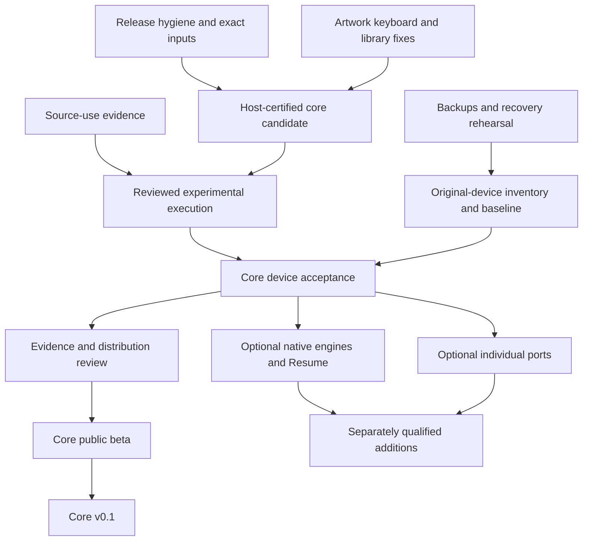

# TrimUI master plan — 22 October 2026

**Recommendation:** finish and qualify a focused PSP-style experience for the original TrimUI Smart Pro on pinned spruceOS/PyUI. Release the core interface with existing emulators first; treat patched engines, authenticated Resume and showcase ports as separately qualified additions.

The original 22 October text is a researched execution plan; current completion is recorded in the execution updates below. Research covers the repository, pinned upstream source, current upstream changes, manufacturer firmware documentation, port launchers and licences. No physical device was tested, software installed, upstream notification sent or release published during this review.

Latest completion update, 23 October 2026: **14 of 25 rows are complete for their stated current scope**: R01–R05, U01–U04, D01, D04 and P01–P03. These comprise 13 host engineering rows and R05's owner-confirmed private noncommercial source-use decision. The [completion report](completion-2026-10-23.md) records the implemented private runtime, backup/restore payloads, casebook review and release handoff. R05 evidence is a retained, freshly retrieved owner attestation; correspondence was not independently inspected and broader distribution grants are not inferred. D01 is conditional software engineering, with real D02/D03 prerequisites still enforced. **Zero of 13 physical areas have run**; the device is unavailable. The original-only dev12 preview's exact checks/build/source/custody identities are in [current verification](../evidence/completion-20261023/verification.json). Production gates remain false; no device release is published.

Historical ten-item execution update, 23 October 2026: **R01–R04, U01–U04, D04 and P01–P03 remain complete** as host engineering: 12 of 25 tasks. The [new ten-item batch](continuation-2026-10-23.md) advances D01, D03, R06, O01 and O03 without completing their physical, permission or operational requirements. Strict local checks pass **833 tests** (772 host/source + 61 PPSSPP), zero skips/failures/errors, on clean source `0585e1de62b1e38b291a96eed7793464c4f272e1`. The original-only dev11 build and no-Git export rebuild pass. See [current verification](../evidence/continuation-20261023/verification.json). All 13 physical areas remain untested. R04 private custody and historical receipts remain unchanged. The reviewed checkpoint and research observations below retain their earlier scope; their old test counts are historical.

Reviewed checkpoint: `a7a735726b8635fb606e38e079d11ae8f0cdaa41`, branch `build/spruce-psp-experience`. This plan supplements the active [TRIMUI_PLAN.md](../../TRIMUI_PLAN.md); the collapsed historical CrossMix/C++ plan remains historical. Source observations are distinguished below from proposed work and hardware hypotheses.

## 1. Where we actually are

| Area | Evidence at the reviewed checkpoint | Remaining boundary |
|---|---|---|
| Interface and host integration | PSP crossbar, library/search/favorites/recents, accessibility, settings routes, launch ownership and restoration implemented | Actual screen, input, boot and lifecycle behavior |
| Automated checks | 561 passed: 500 host/source + 61 PPSSPP; zero errors, failures or skips | Host checks do not establish physical reliability |
| Native engine work | Recorded full PPSSPP/FFmpeg and RetroArch/IGM cross-builds; respective 16- and 23-object SDK audits | Recover/rebuild actual outputs; prove runtime/source identity, rights and device behavior |
| Packaging | Signed original-only dev6 preview, payload hashes, staging, health confirmation, rollback and key registry exist | Operational signing, durable storage and device-qualified delivery |
| Hardware | All 13 acceptance areas unrun, zero attempts | Entire physical qualification programme |
| Release | PR #1 open, draft, unmerged; no GitHub releases | Supported scope, evidence review and distribution requirements |

The successful [CI run](https://github.com/daniel1990000/CrossMix-OS-project/actions/runs/39822730380) tested `8768ab042da2c89c0087d068453bfd58f68445f5`. The reviewed head adds documentation/evidence only; runtime code is unchanged. The existing artifact is a host preview, not an SD image. Its recorded expiry is **20 January 2027**. Native private outputs are not established as recoverable in the replacement workspace.

All production hardware/runtime/source-use qualification gates remain false. No measured device FPS, battery gain or physical Resume durability is established.

## 2. Product scope and release stages

**Core v0.1 recommendation:** original TG5040; pinned spruceOS v4.5.4/PyUI; PSP-style browse/search/favorites/recents; readable controller UI; common settings through existing authorities; reliable launch/return using existing installed engines; classic fallback; supported save/migration boundaries; recoverable installation.

Proposed initial qualification matrix is firmware **1.1.1 and FAT32**, consistent with current upstream/profile guidance. First record the owner's actual firmware and filesystem. This proposal does not authorize or require an automatic firmware flash. Other firmware, filesystems and Smart Pro S/Brick/Flip need separate evidence.

| Stage | Meaning of done |
|---|---|
| Development preview — current | Host implementation and clearly labelled synthetic previews; hardware claims excluded |
| Prepared private alpha | Host fixes, exact inputs, source-use evidence, recoverable experimental execution route and casebook ready |
| Tested private alpha | Named TG5040 candidate exercised; raw evidence and failures retained; no automatic production promotion |
| Public core beta | Core scope passes physical gates, distribution review, restore rehearsal and reproducible installation; limitations published |
| Core v0.1 | Beta regressions resolved, supported matrix fixed, repeatable clean install/update/rollback and maintenance owner established |
| Expanded experience | Each optional engine, Resume mode and port passes its own source/runtime/device criteria |

“Core done” must have a bounded definition. “Every emulator, port and future enhancement done” is not a useful release target. Disabled optional features must be visibly unavailable and excluded from claims, not counted as passing tests.

## 3. What deeper research changed

| Finding | Confidence and implication | Planned response |
|---|---|---|
| Legacy CrossMix release workflow still triggers on `v*`, has write permissions and removes root LICENSE before broad packaging | Confirmed source; hardcoded old paths failing would not be protection | Isolate before any new version tag |
| Missing pinned source can produce unittest skips while the runner exits successfully | Confirmed source; the recorded 561-check run had zero skips and remains valid | Certification fails on unexpected skips/source mismatch |
| CI consumes `docs/spruce-source-lock.json` but omits it from trigger paths | Confirmed source | Add trigger coverage |
| Builder/docs still default to dev4 while CI chooses dev6 | Confirmed source | One current descriptor; preserve historical locks |
| Source adapter can provide QOI artwork, but project decode paths do not cover all upstream formats | Confirmed source incompatibility | Codec capability matrix, bounded normalization or decoder support |
| Artwork and negative caches are path-based | Confirmed source design; same-path replacement needs invalidation | Revision-aware cache and refresh tests |
| On-screen keyboard uses fixed sizes and desktop-oriented hints | Confirmed source | Controller-first hints and text-scale/layout tests |
| Authenticated Resume is tied to the current kernel boot and exact profile/config hashes | Confirmed contract | Same-boot wording; cold-boot Resume separate design |
| Ordinary PPSSPP config rewrites might invalidate the whole-file fingerprint | Qualification hypothesis, not a reproduced device defect | Exercise real native writes; retain strict checks until reviewed compatibility rules exist |
| `qualified_runtime.configuration()` returns None | Confirmed deliberate gate | Build a reviewed experimental execution route before promising device testing |
| SmartPro upstream startup bypasses Flip's session supervisor | Confirmed stable and current Development source | Explicit TG5040 early-failure recovery procedure |
| Benchmark fields for FPS/frame time/input latency/audio/energy are null | Confirmed source | Add measurement methods before performance claims |
| PortMaster platform.py is now a marker; native spruce implementation lives elsewhere | Confirmed current upstream | Inventory the executed generation, not only the marker |
| Celeste repack checks status after echo | Confirmed upstream source defect; not observed device failure | Failure-injection fix before Celeste qualification |
| Sonic inventory omits Game.so and supporting library requirements | Confirmed manifest/launcher mismatch | Complete dependency inventory |

Sources: [legacy workflow](https://github.com/daniel1990000/CrossMix-OS-project/blob/a7a735726b8635fb606e38e079d11ae8f0cdaa41/.github/workflows/CrossMix%20Release.yml), [CI](https://github.com/daniel1990000/CrossMix-OS-project/blob/a7a735726b8635fb606e38e079d11ae8f0cdaa41/.github/workflows/smartpro-offshoot.yml), [runner](https://github.com/daniel1990000/CrossMix-OS-project/blob/a7a735726b8635fb606e38e079d11ae8f0cdaa41/project/dev/check.sh), [artwork adapter](https://github.com/daniel1990000/CrossMix-OS-project/blob/a7a735726b8635fb606e38e079d11ae8f0cdaa41/project/psp_shell/adapters/spruce.py), [renderer](https://github.com/daniel1990000/CrossMix-OS-project/blob/a7a735726b8635fb606e38e079d11ae8f0cdaa41/project/psp_shell/ui/renderer.py), [state evidence](https://github.com/daniel1990000/CrossMix-OS-project/blob/a7a735726b8635fb606e38e079d11ae8f0cdaa41/project/psp_shell/state_evidence.py), [runtime gate](https://github.com/daniel1990000/CrossMix-OS-project/blob/a7a735726b8635fb606e38e079d11ae8f0cdaa41/project/bridge/qualified_runtime.py), [benchmark](https://github.com/daniel1990000/CrossMix-OS-project/blob/a7a735726b8635fb606e38e079d11ae8f0cdaa41/project/tools/benchmark.py). Port sources appear in section 8.

## 4. Prioritized execution register

**R01–R04, U01–U04, D01, D04 and P01–P03 are complete as host engineering; R05 is complete for owner-confirmed private noncommercial source use. The other 11 rows remain open.** P0 means a prerequisite for the named activity, not that every optional feature blocks the core release. Owners: **engineering** = assistant/developer work; **operator** = owner with physical device; **maintainer** = release owner/source-use correspondence. Effort bands are rough engineering sizing: S up to a focused day, M several focused days, L multiple iterations. They exclude external response time and hardware debugging; they are not delivery dates.

| ID | Priority / owner / size | Deliverable and completion criteria | Depends on |
|---|---|---|---|
| R01 | P0 / engineering / S | Disable or isolate inherited release automation. Smart Pro tags cannot invoke CrossMix packaging; reviewed allowlist retains notices. Inspect events without creating a release tag. | None |
| R02 | P0 / engineering / M | Certification runner rejects missing/mismatched sources and unexpected skips; records source IDs and actual counts. Add source-lock CI trigger. Do not hardcode 561 forever. | None |
| R03 | P0 / engineering / M | Current release descriptor selects frontend commit, base/PyUI, extension set, binary hashes, evidence and release ID. CLI/docs agree; historical evidence untouched. | None |
| R04 | P0 before native use / engineering + maintainer / M–L | Recover/hash-check or rebuild binaries with matching source/build archives; demonstrate retrieval from retained storage. New digest gets a new record. Retain original-only preview before expiry. | R03 |
| R05 | P0 before derivative assembly / maintainer / S + external action | Complete prepared noncommercial PyUI notice and retain actual delivery/scope evidence privately. Owner must explicitly instruct sending or supply evidence. | Exact scope |
| R06 | P0 before binary distribution / engineering + maintainer / L | Component ledger distinguishes tools, linked code, bundled libraries, device dependencies and assets; resolve exact recipe/IGM/SDK terms and corresponding source/notices. | R03, R04 |
| U01 | P1 / engineering / M | Test PNG/JPEG/BMP/WEBP/QOI capability across host and embedded paths; choose bounded decoding/normalization, safe malformed/oversize handling and consistent placeholders. | None |
| U02 | P1 / engineering / M | Invalidate image and negative caches when artwork changes at the same path; bound memory and refresh without losing selection. | U01 |
| U03 | P1 / engineering / M | Keyboard scales with accessibility settings, fits 1280×720, offers accurate controller help, punctuation/space/delete/cancel and predictable focus. Define supported text entry/localization explicitly. | None |
| U04 | P1 / engineering / M | Large-library fixtures test startup/search/navigation, long/non-Latin names, duplicate basenames and empty/corrupt entries. Establish budgets against baseline; preserve stable selection. | Measurement design |
| D01 | P0 before device activation / engineering / L | Trusted private experimental harness/manual procedure identifies exact candidate, checks ownership/runtime, supports bounded exit and recovery, and writes durable evidence. No editable flag or card JSON can grant production qualification. | R03, R05; R04 if native candidates used |
| D02 | P0 before device activation / engineering + operator / M | Verified card, save and necessary internal-file backups; separate overlay/card/internal recovery instructions; offline classic fallback and restore rehearsal on expendable media. | Inventory |
| D03 | P0 before device activation / engineering + operator / M | Record actual TG5040/firmware/filesystem/runtime; verify kernel APIs, /proc identity and required probe tooling including readelf. Static ELF inspection is labelled separately from live evidence. | D02 |
| D04 | P1 / engineering / M–L | Measurement tooling captures frame timing where possible, CPU/tree memory and reproducible scenes; physical video/power methods separately specified. Unmeasured metrics remain unavailable. | None |
| D05 | P1 / engineering + operator / L | Execute 13-area casebook in stages; retain raw logs, exact hashes, expected/actual result and recovery outcome. | R02, U01–U04, D01–D04 |
| D06 | P1 / engineering + maintainer / M | Independently review device evidence; create narrowly bound production runtime configuration only for supported candidate. No automatic promotion from report or signature. | D05, applicable R06 |
| N01 | P1 optional / engineering + operator / L | Qualify PPSSPP then RetroArch candidate individually: identity, native controls/theme, launch/return, save compatibility, failure recovery and performance. | R04–R06, successful core pilot |
| N02 | P1 optional / engineering + operator / L | Qualify same-boot Resume with real save/load proof, stale/replay rejection, profile changes and benign native INI writes; reboot falls back to Launch/native saves. | N01, D01 |
| P01 | P0 before port qualification / engineering / M | Inventory actual PortMaster platform package, spruce helpers, selected engine, Game.so/libraries and managed runtimes; cover installed-generation/self-update transitions. | None |
| P02 | P0 for Celeste only / engineering / M | Correct pinned preparation status handling; inject failed repack/mount/low-space cases, require nonzero result, no false completion marker and retry/cleanup. | P01 |
| P03 | P1 optional / engineering / M | Stage-aware data/runtime/preparation readiness, per-port save registry and uninstall/restore contract; Render96 generated output and Celeste managed runtime recognized. | P01 |
| P04 | P2 optional / operator + engineering / L | Qualify Sonic Mania first, then one classic GTA if owned and appropriate; publish exact per-title results. | P01, P03, core pilot, applicable rights |
| O01 | P1 before public device release / maintainer + engineering / M | Operational trust root/key custody, rotation/revocation/recovery exercise using existing signing system; no private keys in Git. | R03 |
| O02 | P1 / engineering + maintainer / M | Release bundle has stable download, hashes, source/notices, exact support matrix, install/update/restore, known issues, support export and screenshots labelled by provenance. | R02–R06 as applicable, D06, O01 |
| O03 | P2 / engineering + maintainer / M | Maintenance matrix and clean rebuild report; scoped upstream-drift reviews, bug triage and requalification rules. | R03, first pilot |

**R04 private custody, scoped R05 source use and D01 software engineering are complete.** D01 now connects its restrictions and bounded return to the actual embedded/principal/resident boundaries, with independent review and real host subprocess composition. D02 has actual backup-payload/expendable-restore tooling; D03 has read-only inventory/kernel tooling. Physical recovery and target readiness remain unrun. R06 now includes full retained-source inspection and exact native link/notice provenance; its remaining public distribution scope stays open. No host result promotes a device runtime.

## 5. Dependencies and decision gates

Gate A: can we identify and retrieve the exact candidate and sources? If not, stop candidate assembly, continue host fixes.

Gate B: can the operator recover from early failure and run the experimental candidate without weakening production gates? If not, resolve D01–D03.

Gate C: does the defined core candidate pass its physical scope? A failure becomes a reproducible defect with retained evidence; optional functionality may be excluded explicitly.

Gate D: can we distribute the exact proposed bytes and maintain verification/recovery? Only then prepare public device delivery. Planning completion is not release authorization.

## 6. Device programme and measurement

Preserve the existing minimum **10 cold boots, 20 normal/PSP appearance switches, 20 launch/quit cycles across applicable runtimes, and 10 sleep/wake cycles**. The runbook must identify which UI/emulator contexts each cycle covers; aggregate counts alone must not conceal an untested context. For optional omitted ports/engines, publish explicit scope exclusions rather than marking their cases passed.

Test sequence:

1. Inventory and restore rehearsal, including original bytes/permissions for relevant internal launcher/FN changes. A hash list is not a backup.
2. Classic pinned spruce baseline with unchanged installed engines, fixed brightness/radios/clocks and representative content.
3. PSP frontend with those same engines: navigation, appearance, launch/return, cancel/failure, settings and sleep.
4. Faults using disposable copies: malformed configs/assets, missing core/launcher, full/read-only storage, interrupted package transaction, persistent processes, USB export and recovery.
5. Optional native engines, then individual ports, each with exact independent identity/settings/save evidence.
6. Sustained performance and endurance; retain raw observations and limits.
7. Independent review and a deliberate production qualification decision.

The 13 areas remain: **restore; boot; input; library; launch/return; save/Resume; native controls; appearance; settings; power/sleep; USB; storage/updates; ports**.

Required observations include both sticks, pad discovery with USB audio/controller present at boot and hotplugged, restored display/input/audio ownership after exit, real save readback, classic fallback, no stranded processes/mounts, radio/sleep behavior and shared writers during shutdown/USB export. Do not duplicate upstream power or input owners.

Kernel/API probes cover child subreaper/wait behavior, memfd sealing or reviewed fallback, peer credentials and /proc process identity. Resolve trusted Python/readelf availability before the session. Device evidence must survive reboot and card export.

**Measurement policy:** baseline first, then choose explicit regression budgets before candidate comparison. Record median/p95/worst startup and navigation timing, frame intervals at the actual rendering boundary where available, CPU including children, memory growth and peak RSS/PSS where available. Summed RSS may double-count shared pages. Internal frame timestamps do not establish panel input latency: use an appropriate external video method for that claim. Use validated energy measurement for battery claims; short battery-percentage snapshots are insufficient. Record temperature only where measurable. No overclock during baseline qualification.

An upstream battery-consumption issue is a test lead, not a benchmark. Current `benchmark.py` supplies useful resource sampling but does not measure smoothness, audio faults, latency or battery energy.

References: [device runbook](https://github.com/daniel1990000/CrossMix-OS-project/blob/a7a735726b8635fb606e38e079d11ae8f0cdaa41/project/docs/device-test-runbook.md), [recovery](https://github.com/daniel1990000/CrossMix-OS-project/blob/a7a735726b8635fb606e38e079d11ae8f0cdaa41/project/docs/recovery.md), [installed-runtime evidence](https://github.com/daniel1990000/CrossMix-OS-project/blob/a7a735726b8635fb606e38e079d11ae8f0cdaa41/project/docs/installed-runtime-evidence.md), [manufacturer firmware](https://github.com/trimui/firmware_smartpro/releases/tag/v1.1.1), [SmartPro configuration](https://github.com/spruceUI/spruceOS/blob/d45ff8dfe5756147522b04ae5863d17a90e88b54/spruce/scripts/platform/SmartPro.cfg).

## 7. Resume, saves and interface contract

**First core release:** native saves and normal Launch remain the dependable contract to qualify. Enhanced Resume stays off unless separately accepted. Current authenticated state records are boot-bound; the feature is Resume across frontend restarts within the same boot, not verified continuation after power-off.

For optional same-boot Resume, test exact engine/config/state identity, successful real load, rejection of stale or incompatible records, writer quiescence, failed load and profile change. Whole-file configuration hashes can invalidate a profile after native writes; investigate actual behavior before designing a narrower compatibility fingerprint.

Cold-boot Resume is later engineering: revalidate engine, configuration, state and writer identity on the new boot, then verify loading through the native authority. Persisting the volatile authentication key on the SD card is not an acceptable shortcut.

Current CrossMix migration covers favorites/recents and compatible battery saves with journaled undo. It does not convert save states or provide universal PSP/port save migration. Define the supported formats and conflict behavior; retain original owner files. First-release backup can be a clear, verified offline procedure. A rotating local snapshot interface is a worthwhile later feature.

UI acceptance should include readable large text, accurate controller prompts, a complete supported keyboard character set, focus restoration after overlays, consistent errors, missing/changed artwork, malformed files, long titles and representative large libraries. Preserve duplicate-basename upstream preset behavior unless a coordinated migration is explicitly designed.

Native third-party menus will not all become PSP-styled automatically. Publish which surfaces are original UI, patched PPSSPP/IGM or unchanged native screens.

References: [Resume contract](https://github.com/daniel1990000/CrossMix-OS-project/blob/a7a735726b8635fb606e38e079d11ae8f0cdaa41/project/ppsspp/state-session.md), [state verification](https://github.com/daniel1990000/CrossMix-OS-project/blob/a7a735726b8635fb606e38e079d11ae8f0cdaa41/project/psp_shell/state_evidence.py), [migration tool](https://github.com/daniel1990000/CrossMix-OS-project/blob/a7a735726b8635fb606e38e079d11ae8f0cdaa41/project/tools/migrate_crossmix.py), [visual design](https://github.com/daniel1990000/CrossMix-OS-project/blob/a7a735726b8635fb606e38e079d11ae8f0cdaa41/project/docs/psp-visual-design.md).

Additional acceptance details: keyboard maximum text scale is 1.75; all 40 current keys must remain readable/selectable. External SDL text input accepts strings, so controller-keyboard limitations do not imply all Unicode input is unsupported. Test font coverage explicitly. Reboot invalidates Resume authentication, not the stored save files. Measure verification hashing latency on real SD media separately from UI frame rate. Keep asynchronous artwork loading bounded and reject stale worker completions after a refresh.

## 8. Ports programme

Retain PortMaster's launcher/controller/cleanup authorities. A port catalogue entry, source availability and source support for spruce do not establish redistribution clearance or playable TG5040 performance.

| Order | Candidate | Prerequisites and acceptance focus |
|---|---|---|
| 1 | Sonic Mania base game | Owner Data.rsdk; sonicmania, Game.so, libs and helpers inventoried. Custom noncommercial RSDK terms; no Plus-enabled distributed build. Verify launch-time display settings, controls, saves and return. |
| 2 | One of GTA III / Vice City | Owner original classic PC data, not Definitive Edition; exact selected re3/reVC graphics executable and engine rights reviewed. Sentinel files alone do not prove complete data. |
| 3 optional | Render96 | Matching owner US ROM, extraction tools/generated assets and workspace. Preparation may consume imported ROM; keep owner original elsewhere. conf is a save path. Start with baseline graphics. |
| Later | Celeste | Supported owner files, Mono squashfs, FNA/repack helpers; preparation failure fix first. Verify savedata bind mount, failed mount/repack/low space, retry and cleanup. |
| Deferred | San Andreas | Keep disabled/experimental until a separate credible source/runtime/device programme exists. |

Each qualified title needs fresh preparation, second launch and cold-restart launch; controller coverage; meaningful save/quit/reload; clean return and no leftover mounts/processes; failed launch/retry; backup/uninstall/reinstall/restore; a repeatable gameplay measurement and real labelled capture. Proposed initial smoke gate: three successful launch/save/return cycles plus a representative longer play session, followed by the broader lifecycle matrix. This is a proposal, not completed testing.

Inventory current native PortMaster spruce code in `platform/miyoo.py` and registration in `platform/__init__.py`, along with device logic and helpers. The old `platform.py` marker is insufficient. The wiki's older support caveat conflicts with newer native implementation; qualify installed code rather than claiming blanket official support.

Sources: [project profiles](https://github.com/daniel1990000/CrossMix-OS-project/blob/a7a735726b8635fb606e38e079d11ae8f0cdaa41/project/profiles/ports.json), [source locks](https://github.com/daniel1990000/CrossMix-OS-project/blob/a7a735726b8635fb606e38e079d11ae8f0cdaa41/project/profiles/ports-sources.lock.json), [PortMaster platform at ccea6b7](https://github.com/PortsMaster/PortMaster-GUI/blob/ccea6b746827d0ae3a1cad744f6e8ccc5a032041/PortMaster/pylibs/harbourmaster/platform/miyoo.py), [packaging guide](https://portmaster.games/packaging.html), [Sonic](https://github.com/PortsMaster/PortMaster-New/tree/main/ports/sonic.mania), [RSDK licence](https://github.com/RSDKModding/RSDKv5-Decompilation/blob/master/LICENSE.md), [GTA III](https://github.com/PortsMaster-MV/PortMaster-MV-New/tree/981df31d3eedd77c7636f0589ed02bc3989698cd/ports/gta3), [Render96](https://github.com/PortsMaster-MV/PortMaster-MV-New/tree/981df31d3eedd77c7636f0589ed02bc3989698cd/ports/render96ex), [Celeste repack](https://github.com/PortsMaster/PortMaster-New/blob/main/ports/celeste/celeste/repack.src). Celeste reviewed repack blob: `6092f48178c116032eb01b30f6b884379f4c1c76`. Mutable main/master links describe source observed on the research date.

## 9. Release, source use and maintenance

Keep two delivery tracks: **original-only host preview** and **combined/device candidate**. Outstanding derivative/runtime obligations should not freeze unrelated original host work.

The pinned outer PyUI licence requires noncommercial redistribution notification; the nested main-ui licence also covers noncommercial use including derivatives. Retain exact notice text, recipients, delivery and scope evidence privately. These clauses require notification, not an assumed affirmative reply. Commercial use requires prior written permission. No correspondence was sent during this research.

PPSSPP GPL-2.0-or-later and RetroArch GPL-3.0-or-later do not resolve separate recipe/IGM/SDK terms. Review actual linked FFmpeg components, static C++ runtime, libraries and assets. The PVR recipe describes proprietary SDK inputs; missing root licences for exact recipe trees remain an unresolved scope, not permission to label everything GPL/MIT. Matching sources and notices must accompany the applicable binary distribution.

Reuse existing Ed25519 verification, payload/path checks, staging, health confirmation, rollback and key registry. Remaining work is release ownership, external key custody, independently distributed trust roots, tested recovery/revocation, exact version selection and durable custody.

Every release record should bind: frontend/base/engine commits; extension selection; build environment and toolchain; artifact/source digests; notices; device/firmware/filesystem; test evidence; support exclusions; installer/update/rollback scope; known issues. Changing a binary, source seam, firmware or base invalidates the relevant qualification until reviewed.

Maintain scoped upstream-drift reviews rather than rebasing during acceptance. Current stable remains spruce v4.5.4. Development `024887876119aa8a87b104dd69120724a5c33ce3` includes post-stable TrimUI OSD removal `2923d0c9e7177fa9b722666682254e28d7380201`; assess that delta later against volume/settings ownership.

References: [qualification](https://github.com/daniel1990000/CrossMix-OS-project/blob/a7a735726b8635fb606e38e079d11ae8f0cdaa41/project/docs/release-qualification.md), [rights](https://github.com/daniel1990000/CrossMix-OS-project/blob/a7a735726b8635fb606e38e079d11ae8f0cdaa41/project/docs/release-rights.md), [continuation review](https://github.com/daniel1990000/CrossMix-OS-project/blob/a7a735726b8635fb606e38e079d11ae8f0cdaa41/project/docs/continuation-rights-review.md), [packaging](https://github.com/daniel1990000/CrossMix-OS-project/blob/a7a735726b8635fb606e38e079d11ae8f0cdaa41/project/packaging/README.md), [PyUI outer licence](https://github.com/spruceUI/spruceOS/blob/d45ff8dfe5756147522b04ae5863d17a90e88b54/App/PyUI/LICENSE.md), [nested licence](https://github.com/spruceUI/spruceOS/blob/d45ff8dfe5756147522b04ae5863d17a90e88b54/App/PyUI/main-ui/LICENSE.md), [PVR recipe](https://github.com/spruceUI/PPSSPP-spruce/blob/9f770cb984fd8ffcc8f91d24fcbca859439c2e9b/README.md), [IGM source](https://github.com/spruceUI/RA/blob/71d84da4dc88945177a3eb34268013355c705dbd/common_src/spruce_igm_theme.c).

## 10. Worthwhile additions after core qualification

| Opportunity | Value | When and prerequisite |
|---|---|---|
| Local save snapshots and restore UI | Protects progress and simplifies experimentation | First extension after exact save-path registry and offline restore proof |
| Better metadata/artwork refresh | Makes large libraries easier to browse | After codec/cache fixes; bounded processing and clear source attribution |
| Theme variants and accessibility polish | Personalization without changing system authorities | After controller/text-scale acceptance; original assets only |
| Localization | Broader usability | Font coverage, keyboard entry, layout and native-route boundaries defined |
| Per-game compatibility notes | Useful settings and honest expectations | Only measured, exact engine/game versions; reversible settings |
| Native achievements integration | Reuses existing ecosystem | Existing emulator routes, credential handling and actual device support; no replacement service |
| Optional Syncthing | Convenience across devices | Local backup/restore first; conflict and shutdown-writer tests; explicit opt-in |
| More ports/devices | Broader audience | Separate source/runtime/device matrix for each |
| Formal SPDX/CycloneDX and independent rebuild | Better downstream maintenance | Start component ledger now; export format and independent reproduction later |

Syncthing propagates changes/deletions. Its versioning is optional, per-folder/per-device and archives remotely received changes, not local edits. It is not a substitute for independent local backups. [Official versioning documentation](https://docs.syncthing.net/users/versioning.html).

Do not prioritize a new OS/frontend rewrite, blanket engine upgrades, overclocking, replacement power management, broad OTA rollout or promises covering every device. Knulli is a useful comparison/reference, but changing base requires a new integration and recovery programme; its Smart Pro docs describe stock calibration and extracted boot/kernel dependencies. No measured evidence here supports a rebase as the faster route. [Knulli device documentation](https://knulli.org/devices/trimui/smart-pro/).

Optional UI refinements: measured two-line focused titles before animated marquees; a screen/action coverage matrix showing every advertised route and return path; and, only if existing source metadata is insufficient, a bounded read-only PPSSPP metadata exporter using native SFO/PBP parsers. Do not introduce a second ROM scanner or reuse another platform's UI framework just to obtain these behaviors.

## 11. Immediate handoff and release pack evolution

**Completed first batch:** R01 archives the inherited release workflow outside Actions discovery while retaining its exact bytes and reviewing notice allowlists. R02 requires the three untouched pinned source checkouts, rejects skips and incomplete suites, and records actual identities/counts. R03 makes the current dev7 descriptor the CLI/CI authority and binds signed metadata to the frontend revision and actual original-source inventory. Historical source locks and build evidence are preserved.

**Completed second batch:** U01 adds bounded PNG/JPEG/BMP/static WebP/QOI handling through both decode paths; U02 adds controller-accessible metadata/artwork refresh, stable page/focus and rejection of stale completions; U03 scales all keyboard text through 1.75 with 50 keys, title punctuation, physical help and defined Unicode limits. Dev8 is the current original-only host preview. Target codecs, rendering and input still need device acceptance.

**Completed third batch:** U04 adds 10,000-entry fixtures, bounded live query caching, Unicode search and safe malformed/empty entries; D04 adds real presentation-boundary timing, child CPU/PSS and fixed-scene methods; P01 inventories actual PortMaster generations, helpers, Game.so/libraries and managed runtimes; P02 fixes Celeste preparation/cleanup failures in exact-source host tests; P03 adds stage-aware readiness and external save backup/restore with undo. Dev9 is the current original-only host preview. Strict certification now requires five pinned source checkouts and passes all 690 checks. The first full attempt exposed a retained-binding refresh regression; its failure is retained separately and the corrected source passes the complete run.

**Current continuation:** R04 is complete through new private native builds and actual source/build/image retrieval. Dev10 adds the offline backup verifier; its 20 tests and independent fault/race review pass. D01 design, D02/D03 preparation and a 16-scope native component ledger are retained. D01 remains unimplemented for device admission, and D02/D03 physical work remains unrun. R05 requires actual owner-authorized notice delivery/evidence; R06 retains exact native distribution questions. Keep runtime gates false and retain the draft PR until device qualification.

**Next operator preparation:** exact device/firmware/card inventory, expendable card and verified original saves, recovery payloads, representative owner content and a way to retain logs/video. Prepare scripts and casebook before consuming device time.

**External dependency:** actual PyUI notice delivery/source-use record and remaining exact binary terms. Continue independent host work while these are pending. Do not fabricate delivered notice evidence or treat a fixture review object as clearance.

**Next review:** confirm which core cases can execute with unchanged engines, resolve the experimental execution gap, then run baseline and core device acceptance. Record observed results before deciding production configuration.

The existing [release pack](https://chatgpt.com/space/page_45bef6d344508191ad5533d3c1b02fbb) remains a dated development-preview record. Add genuine device captures only after testing, labelled with exact build/device. Existing SDL host renders must keep “synthetic sample metadata; not a device photograph.” Avoid Sony reference imagery in distributed original project assets.

Current concise statement:

> Smart Pro PSP experience is a development preview for the original TrimUI Smart Pro, built on spruceOS/PyUI. The host implementation passes 710 automated checks. Twelve master-plan tasks are complete as host work, including private native artifact custody. The device route and recovery/inventory procedures are prepared; implementation, physical testing and source-use/distribution evidence remain open.

A future release statement should replace the last sentence with the exact physically supported scope and link its evidence. Do not announce “all done,” universal Resume, improved battery life or a device-ready image before those claims are demonstrated.
